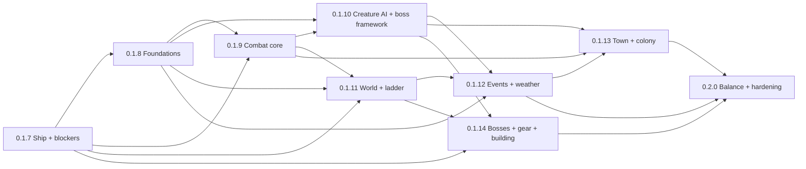

# Rimtera roadmap: 0.1.6 → 0.2.0

Planning document, written 2026-10-28 on `main` (v0.1.6 released 2026-10-23, plus the uncommitted session work). No game code was changed to write it.

**Inputs.** The nine-area breakdown in `docs/breakdown/01..09` (196 integration steps: PC-1..21, BO-1..24, EN-1..18, EV-1..17, WT-1..18, IC-1..23, PU-1..29, NC-1..25, PE-1..21), plus the open items in `docs/CONTROLS_PARITY.md`, `docs/CRAFTING_PROGRESSION.md`, `docs/QUEUED_WORK.md` and `docs/TERRARIA_GAPS.md`.

**Detailed plans, one per step:** [0.1.7](roadmap/0.1.7.md) · [0.1.8](roadmap/0.1.8.md) · [0.1.9](roadmap/0.1.9.md) · [0.1.10](roadmap/0.1.10.md) · [0.1.11](roadmap/0.1.11.md) · [0.1.12](roadmap/0.1.12.md) · [0.1.13](roadmap/0.1.13.md) · [0.1.14](roadmap/0.1.14.md) · [0.2.0](roadmap/0.2.0.md).

**Status (2026-11-01).** The step numbers below are this roadmap's own. `docs/PLAN.md` later re-cut the work into
milestones, so the released version numbers differ:

| Parity step | Status | Shipped in |
|---|---|---|
| 0.1.7 Ship the session | Mostly not done | Release 0.1.7 shipped the session work (X-SES) and the animation frames (PE-1); the player has no autonomous behaviour (NC-1). The rest of its fix list is not in the code and no milestone holds it: for example the Rust Moon still ends with the Moon Eater before the Fracture (PC-1), the Abyss Leviathan is not gated (PC-3), obelisk shields time out (EV-1), the legacy `EventManager` still runs (EV-2), station inheritance is one level (PC-18), the temple brick has no drill gate (WT-1), sprites load eagerly (PE-2), and there is no boss self-test suite (BO-24). PC-8, PC-9 and IC-5 were replaced by 0.1.8's death drops, and BO-16 by 0.1.11's respawn timer |
| 0.1.8 Foundations | Mostly done | releases 0.1.11-0.1.14 (clock, statuses, event ends, respawn timer, falls, air, bed, Creative split, Hazard row, autosave, movement, mounts, fins, camera, pause rules) and 0.1.9 (buff cancel). Not done: PC-13 (research on the character), PC-14 (Creative kit polish), PU-15 (map fixes), PU-24 (feats and credits on the title), PU-26 (video rows), PE-15 (audio latency and pitch), the screen-shake half of PE-16, and X-CR-10 (Journey weather and spread-freeze powers). They are not scheduled yet |
| 0.1.9 Combat core | Done, all 20 items | release 0.1.15 |
| 0.1.10 Creature AI and boss framework | Not done | planned for 0.4.0 "The storyteller" |
| 0.1.11 World and progression ladder | Not done | planned for 0.5.0 "Pressure" |
| 0.1.12 Events and weather | Not done | planned for 0.4.0 |
| 0.1.13 Town and colony | Not done; partly started | planned for 0.5.0. Already in: selling and buyback, the housing page with residents (0.1.9), arrivals that replace dead crew (0.1.8) |
| 0.1.14 Bespoke bosses, gear depth, building depth | Not done; partly started | planned for 0.6.0 "The escape". Already in: coin and ammo slots (PU-18, IC-22; 0.1.10), pet, light pet, mount and hook slots (part of PU-19; 0.1.9) |
| 0.2.0 Balance and hardening | In progress | On the branch: CI asset check and bench budgets (PE-20), coloured lighting on High (PE-11), the Emotes tab (PU-27), Ironman spectate (PU-28), F8/F9 keys (X-CP-3), the docs pass and the tier-4+ whitelist (X-TG-1, X-CR-1). In work: the boss and difficulty balance (PC-15, BO-23, D-6). Waiting: the D3 play-through sign-off |

Releases 0.1.8 "Stakes", 0.1.9 "Terraria basics" and 0.1.10 "Coin and ammo slots" came from `docs/PLAN.md`, not from
this roadmap. Because most of 0.1.7 and all of 0.1.10-0.1.14 are not done, the 0.2.0 goal in §1.1 is not met in
full at 0.2.0: points 2 (honest progression; see `docs/CRAFTING_PROGRESSION.md` §6), 3 (creature and boss behaviour),
4 (events and weather), 5 (world shape) and 6 (colony) move to the later milestones, and the parity 0.1.7 fixes need a
home in `docs/PLAN.md`.
The per-ID status is in the "0.2.0 status" column of each `docs/breakdown/` file.

---

## 1. Overview

### 1.1 Goal for 0.2.0

> **Rimtera plays as a complete Terraria-parity game with its colony layer integrated.**

In concrete terms, 0.2.0 is done when:

1. **Base mechanics match Terraria.** That covers movement, controls, tools, flora, gear, stats, the clock, statuses, death and respawn, mining gates, healing and debuffs. Terraria is used as behavioural evidence only: no code, names or assets are copied.
2. **The progression is honest.** No hardmode material, tier-6 item or boss stronger than the gate boss can be reached before the Fracture. The craft audit proves this and fails the build if it regresses.
3. **Creatures and bosses behave like their Terraria counterparts.** Fighters jump and drop through platforms, swimmers swim, shooters shoot, creatures have defense and inflict debuffs, and every boss has its own attack patterns. The analogs of the worm, multi-part and wall bosses are built that way.
4. **Events and weather follow Terraria's clock and rules.** They start and end at the right boundaries, spawn in the right places, and change the sky, the light and the music.
5. **The world is Terraria-shaped.** Fracture scars are full width, the jungle runs top to bottom, the pick ladder has its rungs, liquids are present and behave, and there is a space band.
6. **The colony layer serves the Terraria loop.** Crew live at home, guard, garden, haul and cook. They never cost the player anything and never heal the player. Town NPCs fight back, happiness and pylons work as in Terraria, and reforging exists.
7. **It looks, sounds and saves like a finished game.** Armor is visible, every action has a sound, there is dust and gore, event skies and per-tier music. Memory is bounded. Saves cannot be lost.

### 1.2 Settled user decisions (not reopened)

| # | Decision | Where it lands |
|---|---|---|
| 1 | Base mechanics, controls, tools, flora, gear and stats work identically to Terraria (as evidence). "Match Terraria or keep Rimtera's?" defaults to Terraria, except for the Rimtera-only additions in row 7 | All steps; the defaults in §6 |
| 2 | Day length matches Terraria: 24 real minutes (15 day, 9 night). Event timing follows from it (EV-17 decided) | 0.1.8 (EV-17, EV-4) |
| 3 | No automatic eating or healing for the player, and no toggle. The player recovers only through natural regen, gear, buffs and items they use. This also applies to any other free recovery in the breakdowns | Already implemented (0.1.7 ships it); NC-1 verified, NC-2, NC-7 and IC-4 in 0.1.7 |
| 4 | Controls are identical to Terraria's. The wheel acts as in Terraria (no Ctrl+wheel zoom). The recipe guide has no key | Done in controls phase 2 (ships in 0.1.7) |
| 5 | Commit everything, including the ~2,448 generated animation frames | 0.1.7 (PE-1) |
| 6 | Memory was "leave as is", but it doubles once the frames ship, so plan a proper step | 0.1.7 (PE-2), flagged in §8 |
| 7 | Rimtera-only systems stay but serve the Terraria loop: the colony and crew layer, the sci-fi theme, the Fracture as hardmode, the T throw key, the `I` key and emotes | 0.1.13 (colony); kept everywhere else |

### 1.3 Version steps

| Step | Theme | IDs | Size | Depends on |
|---|---|---|---|---|
| [0.1.7](roadmap/0.1.7.md) | **Ship the session and stop the bleeding.** Commit the session work and the art, load sprites lazily, and fix the play-blocking, progression-bypass and data-loss bugs | 34 | L (≈28 agent-days, 5 streams) | 0.1.6 |
| [0.1.8](roadmap/0.1.8.md) | **Foundations: clock, statuses, movement, menus.** A 24-minute day, real-time buffs and regen, Terraria movement feel, respawn rules, the Creative split, autosave, pause rules, map, HUD and audio latency | 23 | L (≈30) | 0.1.7 |
| [0.1.9](roadmap/0.1.9.md) | **Combat core.** Creature defense and immunities, debuffs in both directions, the healing ladder, hitboxes, drop rules, pickups, stacks, tooltips, and sound, dust and combat-text events | 20 | L (≈35) | 0.1.7, 0.1.8 |
| [0.1.10](roadmap/0.1.10.md) | **Creature AI and the boss framework.** Shooters, pathing, swimmers, new AI families, spawn controls, critters, projectile art, bestiary; boss patterns, refusals, enrage, minions, placement and stacked bars | 22 | XL (≈50) | 0.1.8, 0.1.9 |
| [0.1.11](roadmap/0.1.11.md) | **World and progression ladder.** The mining ladder, no hardmode materials before the Fracture, full-width scars, the jungle, structures, liquids, space, biome readings, life to 500, tile rendering | 24 | XL (≈45) | 0.1.7, 0.1.8, 0.1.9 |
| [0.1.12](roadmap/0.1.12.md) | **Events and weather.** Spawn scopes, Terraria triggers, the defend-the-core Defense Protocol, the Martian gate, climate weather, wind, event skies, music, ambience and readouts | 19 | L (≈40) | 0.1.8, 0.1.10, 0.1.11 |
| [0.1.13](roadmap/0.1.13.md) | **Town and colony.** Crew homes, jobs and guards, raids at the colony, NPC defense, the housing menu, happiness, pylons, reforging, the shop grid, move-in gates and new roles | 27 | XL (≈50) | 0.1.9, 0.1.10, 0.1.12 |
| [0.1.14](roadmap/0.1.14.md) | **Bespoke bosses, gear depth, building depth.** Worm, multi-part and wall bosses, the Astro-God, boss loot, core-chips, minion and projectile behaviour, accessories, set abilities, equipment page, ammo and coin slots, banks, visible armor, wiring, paint | 19 | XL (≈60) | 0.1.7, 0.1.10, 0.1.11 |
| [0.2.0](roadmap/0.2.0.md) | **Balance, completion and release hardening.** The boss and gear curve, difficulty scaling, coloured lighting, CI asset and performance gates, the emote menu, Ironman spectate, the docs pass and the full parity play-through | 6 + rollups | L (≈25) | all |

**Deferred past 0.2.0:** PU-29 (multiplayer: out of scope, no stubs) and PE-21 (code signing: needs a certificate the user does not have yet). See §5 for the non-ID items that are also deferred.

### 1.4 Dependency graph (steps)

Every edge points backwards: a step depends only on earlier steps.

Key item-level edges (the reason for the order). Each line reads "needs → is needed by":

- **Clock first.** EV-17 (24-minute day) and IC-1 (real-time statuses), both in 0.1.8, come before every event and buff tuning: EV-3..16, IC-2, IC-3 and BO-11. EV-4 (boundaries) comes before the event content in 0.1.12 and reuses BO-6's dawn helper from 0.1.7.
- **Movement before world and travel checks.** PU-1 (0.1.8) comes before WT-14/PU-4 (space gravity), WT-10/WT-11 (jump-reachable structures), EV-11 (wind push), EN-2 (chase speeds) and BO-1 (boss pacing).
- **Combat before AI and balance.** EN-4/IC-10 (defense), EN-12 (hitboxes), IC-3 (debuffs) and IC-2 (healing ladder), all in 0.1.9, come before EN-1 (shots that hurt), BO-1 (patterns that hit), PC-12 (life 500, because potions must scale) and PC-15/BO-23 (balance in 0.2.0).
- **Boss framework before per-boss AI.** BO-1, BO-2 and BO-10 (0.1.10) come before BO-3, BO-4, BO-19 and BO-20 (0.1.14). BO-10 ships the aggregate-bar API that BO-4 plugs into. BO-1 comes before BO-22 (same step) and EV-7's tier bosses (0.1.12).
- **Gates before content.** PC-7 (audit) comes before PC-1..4 (0.1.7), and before PC-5, PC-6 and WT-2 (0.1.11) and PC-16 (0.1.13). WT-1 (temple seal) comes before WT-10 (temple growth).
- **Zones before scoped spawns.** WT-15 (biome readings, 0.1.11) comes before EV-3 (spawn scopes) and EV-14 (grave field) in 0.1.12.
- **Saves before format changes.** PU-11 (backups, versioned migration, 0.1.7) comes before PU-9 (same step), PC-13, PU-10 and PU-12 (0.1.8), PU-18, PU-19, PU-20 and PC-11 (0.1.14), and WT-18 (paint codec).
- **Town plumbing before the colony.** EN-2 pathing (0.1.10) and EV-5's invasion front (0.1.12) come before NC-5 (crew guards) and NC-19 (raids at the colony) in 0.1.13. IC-3's status list comes before NC-13 (the Medic clears debuffs).
- **Memory before more art.** PE-2 (0.1.7) comes before PE-1 (same step, lands first), PE-3 (armor sheets), EN-14 and IC-11 (projectile art), and NC-22 (NPC sprites).

---

## 2. Version steps (summary; the per-step docs hold the task lists)

Each step's per-step doc gives the full stream table, file ownership, landing order, task-level approach, tests and play-test checklist. The summaries below hold the essentials.

### 0.1.7: Ship the session and stop the bleeding

- **Goals.**
  - Release everything done this session: the crafting chain fix and `--craft-audit`, the crafting guidance, controls parity phase 2, no auto-eat or auto-heal, and the Kiln and Bio Lab equivalences.
  - Ship the ~2,448 animation frames without doubling memory.
  - Close every bug that blocks progression, bypasses a gate or loses work.
- **IDs (34):** PC-1, PC-2, PC-3, PC-4, PC-7, PC-8, PC-9, PC-18, PC-21, BO-6, BO-9, BO-16, BO-17, BO-18, BO-24, EN-6, EN-7, EV-1, EV-2, WT-1, IC-4, IC-5, IC-7, PU-8, PU-9, PU-11, NC-1, NC-2, NC-7, NC-9, NC-16, NC-20, PE-1, PE-2.
- **Streams:**

  | Stream | IDs | Owns |
  |---|---|---|
  | A · Release, art, memory | PE-1, PE-2 | The session commits, `Assets/Sprites`, `UI/SpriteAtlas.cs`, `tools/comfy/`, `QUEUED_WORK.md` |
  | B · Gates and audit | PC-7, PC-3, PC-18, WT-1, PC-21 | `CraftingAudit*.cs`, `GameSimulation.Fishing.cs`, `ContentRecipes.cs`, `CraftingSystem.cs`, `World/ContentTiles.cs`, the progression docs |
  | C · Boss and event lifecycle | BO-24, PC-1, PC-2, PC-4, EV-1, EV-2, BO-6, BO-9, BO-17, BO-18, EN-7 | `WorldEvents.cs`, `GameSimulation.Hardmode.cs`, `.Spawning.cs`, `.World.cs`, `.CreatureCoverage.cs`, `EventManager.cs`, `NpcDropRegistry.cs`, `EnemyAiFamilies.cs`, `BiomeSpawnTables.cs`, `GrowthItems.cs`, new `BossSelfTests.cs`. Hot-file owner of `GameSimulation.cs` |
  | D · Player, death, saves | PU-11, PU-9, PU-8, PC-8, IC-5, PC-9, IC-4, BO-16, IC-7, EN-6 | `GameSimulation.Player.cs`, `.Combat.cs`, `Entities/Actors.cs`, `HealthComponent.cs`, `CharacterFile.cs`, `GameSaveData.cs`, `WorldSaveRepository.cs`, `MenuSystem.cs`, `PreferencesAndProfiles.cs`, `WorldSettings.cs`. Hot-file owner of `GraphicalSandbox.cs` |
  | E · Colony ruling | NC-1, NC-2, NC-7, NC-9, NC-16, NC-20 | `GameSimulation.Town.cs`, `TownNpcs.cs`, `ColonistSheetState.cs`, `Storyteller.cs`; the colonist and needs functions in `GameSimulation.cs` |

- **Depends on:** nothing new. It is cut from `main` with the working tree.
- **Acceptance:**
  - `--self-test` passes with 0 FAIL at ≥ 640 + the new checks (new suites: `BossSelfTests`, `ProgressionGateSelfTests`, `SaveSafetySelfTests`, `ColonyRulingSelfTests`).
  - `--craft-audit` is clean: 0 unreachable, 0 blocked, 0 unbuildable. Its new "Bosses reachable before the Fracture" section lists no boss above the Fission Tyrant's life.
  - `--item-audit` is clean.
  - `git status --porcelain Assets/` is empty.
  - Title-screen memory is ≤ 450 MB with every sprite.
  - A 0.1.6 save loads.
  - Play-test: the Rust Moon has no boss before the Fracture; obelisks hold their shields; a boss left far away leaves; closing the window saves; a second character can play the first one's world.
- **Risks:** PE-2 touches every `_sprites.Get` call site (land it first, then rebase the others). PU-9 changes world-snapshot semantics (migration). IC-4 shares `HealthComponent` with colonists.

### 0.1.8: Foundations (clock, statuses, movement, menus)

- **Goals:**
  - The 24-minute day, with everything per game hour rescaled.
  - Statuses and regen on real seconds.
  - Events end at dawn or dusk.
  - Terraria movement feel (run, jump, gravity, falls, breath, mounts, swimming).
  - Respawn rules and bed spawn.
  - The Creative split and per-character research.
  - Autosave off the UI thread.
  - Terraria pause rules, the Hazard row, map fixes, buff-bar actions, title-screen feats, video rows, camera and shake options, lower audio latency.
- **IDs (23):** EV-17, EV-4, IC-1, PU-1, PU-2, PU-3, PU-5, PC-10, PU-6, PU-7, IC-6, PU-10, PC-13, PC-14, PU-12, PU-13, PU-14, PU-15, PU-16, PU-24, PU-26, PE-15, PE-16.
- **Streams:**
  - A · Clock and statuses: EV-17, IC-1, EV-4.
  - B · Movement: PU-1, PU-2, PU-3, PU-6, PU-7.
  - C · Respawn, Creative, saves: PU-5, PC-10, IC-6, PU-10, PC-13, PC-14, PU-12.
  - D · Menus, HUD, camera: PU-13, PU-14, PU-15, PU-16, PU-24, PU-26, PE-16.
  - E · Audio engine: PE-15.
- **Acceptance:**
  - New suites `ClockSelfTests`, `StatusTimingSelfTests` and `PlayerFeelSelfTests` (PU-1's numeric band). `ParityMovementTests` is updated.
  - A full cycle takes 1,440 ± 10 real seconds.
  - The Regeneration buff gives ≥ 1.5 HP/s, and Poison does 2 ± 0.2 HP/s.
  - A Hollow Moon started at 23:00 ends at 06:00 (dawn, D-29) with no clear.
  - Autosave adds ≤ 17 ms of UI-thread time on Large.
  - Play-test: crossing Small on foot takes 6-8 min.
- **Risks:**
  - EV-17 touches every `GameHoursPerRealSecond` user, and the colony sim drifts. Mitigate with a "per real minute" invariance test for colonist needs.
  - PU-1 invalidates jump-tuned worldgen and AI chase speeds. Later steps re-measure.

### 0.1.9: Combat core

- **Goals:**
  - Creatures have defense, immunities and lava damage, and inflict debuffs.
  - The player has a 4-tier healing and charge ladder.
  - Hitboxes are boxes.
  - Drops have chances and conditions, and event units drop items.
  - Hearts and charge orbs drop. Bosses drop potions.
  - Auto-swing gear works. Stacks are 9999.
  - The tooltip tells the truth.
  - Every action emits a sound event, despawns are silent, block dust exists, and crits read as crits.
- **IDs (20):** EN-4, IC-10, EN-5, EN-18, IC-3, EN-17, EN-12, IC-18, IC-21, IC-15, IC-2, BO-11, EN-10, EN-11, IC-19, IC-17, PE-4, PE-5, PE-7, PE-14.
- **Streams:**
  - A · Creature stats (EN-4, IC-10, EN-5, EN-18).
  - B · Hit pipeline and debuffs (IC-3, EN-17, EN-12, IC-18, IC-21, IC-15).
  - C · Healing, loot, pickups (IC-2, BO-11, EN-10, EN-11, IC-19).
  - D · Feedback (PE-4, PE-5, PE-7, PE-14, IC-17).
- **Acceptance:**
  - New suites `CreatureDefenseSelfTests`, `PlayerDebuffSelfTests`, `HealingLadderSelfTests`, `DropRuleSelfTests`, `SoundEventSelfTests` and `TooltipSelfTests`.
  - The `GearCurve` and `StatParity` time-to-kill bands still pass.
  - `--balance` prints defense.
  - `--craft-audit` is clean, with the potion tiers gated.
  - `--item-audit` is clean.
- **Risks:**
  - Defense changes every time-to-kill. Retune in the same step (IC-10), and land the balance probe before the data.
  - IC-3 Confused touches input.

### 0.1.10: Creature AI and the boss framework

- **Goals:**
  - Every hostile family behaves like its Terraria analog: shooters, fighters that jump and drop through platforms, swimmers, ghosts, chargers, climbers, splitters.
  - Spawn controls and critter rules.
  - Attack frames and projectile sprites.
  - Bestiary detail.
  - A data-driven boss pattern framework with minions, enrage, summon rules (night, zone, per-type), placement, stacked bars with an aggregate API, obelisk shields and mini-boss patterns.
- **IDs (22):** EN-1, EN-2, EN-3, EN-8, EN-9, EN-13, EN-14, EN-15, EN-16, IC-11, PE-12, PE-18, PU-23, BO-1, BO-2, BO-5, BO-7, BO-8, BO-10, BO-15, BO-21, BO-22.
- **Streams:**
  - A · Ground and air AI (EN-2, EN-13, EN-9).
  - B · Shooters, swimmers, art (EN-1, EN-3, EN-14, IC-11, PE-12).
  - C · Spawning, critters, bestiary (EN-8, EN-15, EN-16, PU-23).
  - D · Boss framework (BO-1, BO-2, BO-5, BO-7, BO-8, BO-15, BO-21, BO-22).
  - E · Boss UI and creature sound (BO-10, PE-18).
- **Acceptance:**
  - New suites `EnemyAiSelfTests` (one per family) and `BossPatternSelfTests`. No two bosses share a behaviour signature, and each boss uses at least 2 patterns per phase.
  - `--entity-sprites` shows no shared hostile/critter base and all minion shots resolved.
  - Play-test: a 2-tile wall no longer stops walkers; marksmen shoot.
- **Risks:**
  - BO-1 is the largest single change (L).
  - Signature tests can be flaky. Seed them and use generous bands.
  - Art waits on the user's go; placeholders ship.

### 0.1.11: World and progression ladder

- **Goals:**
  - Each drill opens new ore. No viridium or void essence before the Fracture.
  - Altar ore scales with world size.
  - Fracture scars are 200-250 tiles wide, and walls convert.
  - The jungle runs full height and stays clear of blight.
  - Bigger dungeon, temple, islands and grottos.
  - Cave water and acid pools. Liquid flow rates.
  - A space band with low gravity. Missing biome readings.
  - Life to 500. A vital-crystal analog.
  - No tile seams, no liquid hitch, per-biome cave backdrops, framing variants.
- **IDs (24):** PC-5, WT-7, WT-2, PC-6, WT-6, WT-4, WT-5, WT-10, WT-11, WT-8, WT-9, WT-3, WT-13, WT-12, PE-9, WT-14, PU-4, WT-15, PC-12, IC-23, PC-17, PE-8, PE-19, WT-17.
- **Streams:**
  - A · Ore and mining ladder.
  - B · Biome layout and structures.
  - C · Fracture, spread, liquids.
  - D · Zones, space, growth.
  - E · Tile rendering.
- **Acceptance:**
  - `--craft-audit --items` places `ViridiumOre`, `ViridiumBar`, `VoidEssence`, `VoidDarts`, `VoidFuel` and `ViridiumBolts` at or after the Fracture stage, and the tier-6+ pre-Fracture count is 0.
  - `WorldGenSelfTests` gets new size, width and density checks over 20 seeds.
  - `--engine-bench`: the Fracture takes < 1 s on Large, and the flood worst tick is ≤ 33 ms.
  - Old worlds load.
  - Play-test: the kit drill fails on pyrocite.
- **Risks:**
  - The ladder may block the Fission Tyrant route. The audit guards it.
  - The Fracture reframe cost.
  - Worldgen time on Large.

### 0.1.12: Events and weather

- **Goals:**
  - Event rosters respect location.
  - Terraria-shaped triggers: no Rust Moon on a new moon, Swarm Rain on dry mornings, invasions at dawn with a marching front, Aurora after a first clear, meteor nights.
  - A Martian-analog scout trigger.
  - A defend-the-core Defense Protocol in 3 tiers.
  - One global climate rendered per biome, frame-rate-independent lightning, wind that pushes, Windy Day as a weather state.
  - Moon waves at 15/20 with loot by wave.
  - The grave-field mini-biome, dials, info readouts.
  - Event skies and coloured sky light, music crossfade with event, night and boss-tier themes, ambient beds, weather polish.
- **IDs (19):** EV-3, EV-5, EV-6, EV-13, EV-7, EV-9, EV-10, EV-11, EV-12, EV-8, PE-10, PE-6, BO-14, PE-13, PE-17, EV-14, EV-15, EV-16, PU-17.
- **Streams:**
  - A · Event framework and triggers.
  - B · Defense Protocol.
  - C · Weather and wind.
  - D · Atmosphere, sky, music, ambience.
  - E · Grave field, dials, readouts.
- **Acceptance:**
  - New suites `EventScopeSelfTests`, `WeatherClimateSelfTests` and `DefenseProtocolSelfTests`. A 1,000-night roll table.
  - `--music-preview` renders every event, night and boss-tier theme.
  - Play-test: the Rust Moon sky is red.
- **Risks:** music and sky are art and audio heavy. The art queue is gated on the user's go.

### 0.1.13: Town and colony

- **Goals:**
  - Crew have homes, jobs (gardener, hauler, cook, guard, plus miner as an optional job) and skills that grow. They guard the town and are replaced at a capped rate.
  - Raids walk in at the colony.
  - Town NPCs fight back.
  - A real housing menu and shop grid. Terraria happiness and pylons.
  - The tinkerer NPC reforges and sells the Tinker Bench.
  - The Medic clears debuffs. Move-ins and survivors are gated by progression.
  - New roles: Stylist with the appearance editor, a tax-collector analog, a mushroom vendor.
  - Distinct NPC sprites and dialogue depth.
- **IDs (27):** NC-3, NC-18, NC-21, NC-5, NC-19, NC-4, NC-17, NC-25, NC-10, NC-11, NC-12, IC-13, IC-14, NC-13, NC-15, PU-21, NC-8, PU-22, NC-6, NC-14, PC-19, PC-20, PC-16, NC-23, NC-24, PU-25, NC-22.
- **Streams:**
  - A · Crew life.
  - B · Crew jobs and orders.
  - C · Town economy and reforge.
  - D · Housing, residents, roles.
- **Acceptance:**
  - New suites `CrewSelfTests`, `HappinessSelfTests` and `ReforgeSelfTests`.
  - The craft audit's tier-4+ pre-Fracture list holds only whitelisted items once the Tinker Bench moves.
  - Play-test: crew stay home while the player is in a cave, and a guard kills a slime.
- **Risks:** colony behaviour is open-ended. Keep jobs to chests and stations, and never touch the player's inventory.

### 0.1.14: Bespoke bosses, gear depth, building depth

- **Goals:**
  - Worm bosses (Hive-mind, Cyber-Swarm Leader) and multi-part bosses (Scout Mech, Renegade Overseer, Warship Core, Vault Colossus, Astro-God, Dreadnought, Mothership).
  - The Fission Tyrant as a moving wall. Astro-God phases.
  - Full boss weapon pools and unique core-chips.
  - Minion behaviours and targeting, whip tags, a projectile behaviour library with explosives, the missing accessory families, set abilities.
  - Coin and ammo slots, the equipment page (dyes, vanity, misc), more banks, accessory slots 6 and 7, visible armor.
  - Wiring completeness and paint.
- **IDs (19):** BO-3, BO-4, BO-19, BO-20, BO-12, BO-13, IC-8, IC-9, IC-12, IC-16, IC-20, PU-18, IC-22, PU-19, PU-20, PC-11, PE-3, WT-16, WT-18.
- **Streams:**
  - A · Segmented and multi-part bosses.
  - B · Boss loot.
  - C · Weapons and minions.
  - D · Accessories and sets.
  - E · Inventory, equipment, armor visuals.
  - F · Wiring and paint.
- **Acceptance:**
  - New suites `BossPartsSelfTests` and `EquipmentPageSelfTests`.
  - `--item-audit` shows 0 unread tags, and the core-chips have distinct effect tags.
  - Character and world files from 0.1.13 load.
- **Risks:**
  - The largest step.
  - The save format changes in 3 places. PU-11's migration hooks are mandatory.
  - The armor art.

### 0.2.0: Balance, completion and release hardening

- **Goals:**
  - The time-to-kill curve rises from the first boss to the final boss (the final boss takes at least 2× the Overseer's hits). Every boss sits in a 60-180 s band with tier gear.
  - Brutal and Annihilation scale like Expert and Master.
  - Coloured lighting on High.
  - CI fails on missing art or performance regressions.
  - The emote menu and Ironman spectate.
  - The docs pass (TERRARIA_GAPS, parity docs).
  - A full Terraria-parity play-through from a new character to the Astro-God on Classic and Brutal.
- **IDs (6):** PC-15, BO-23, PE-11, PE-20, PU-27, PU-28. Plus the rollup checks listed in §5.
- **Streams:**
  - A · Balance (PC-15, BO-23).
  - B · CI gates (PE-20).
  - C · Polish (PE-11, PU-27, PU-28, X-CP-3).
  - D · Docs and verification.
- **Acceptance:** a `--boss-balance` report with every boss in band; the Prove matrix with `--asset-check` and the bench job green; the full play-through checklist signed off.
- **Risks:** the balance pass surfaces upstream bugs. Keep a 3-day buffer.

---

## 3. Working rules for parallel agents (every step)

1. **Branching.**
   - Cut an integration branch `dev/0.1.x` from `main` at the start of each step.
   - Each stream works in its own git worktree on `dev/0.1.x-<stream>` and merges into `dev/0.1.x` by PR. Prove runs on every PR.
   - The release PR is `dev/0.1.x` → `main`.
2. **File ownership.**
   - Each step doc names the files each stream owns exclusively.
   - **Hot files** are `Systems/GameSimulation.cs` (2,645 lines), `UI/GraphicalSandbox.cs` (3,893 lines), `Entities/Actors.cs`, `Systems/ItemSystem.cs` and `Systems/CoreSelfTests.cs`. For these, the step doc names the **functions** each stream may edit. New logic goes in the stream's own partial-class file (`GameSimulation.<Topic>.cs`, `GraphicalSandbox.<Topic>.cs`), with at most a one-line call in the hot file.
3. **Append-only enums and records.** `ItemId`, `TileId`, `WallId`, `StatusId`, `EnemyKind`, `EnemyAiFamily`, the `EquipmentSlot` values and snapshot records are append-only, as the codebase already requires. When two streams append to the same enum, the step doc gives the merge order.
4. **Saves.**
   - From 0.1.7 on, every format change goes through PU-11's migration hooks (`FormatVersion <= Current` loads, newer versions are refused).
   - Each change adds a fixture from the previous release under `tests/fixtures/saves/<version>/`, and a self-test loads it.
   - No step may make an older save fail to load.
5. **Self-tests.**
   - Each stream adds its checks in its own `Systems/<Topic>SelfTests.cs`.
   - Only the integrator edits the registration list in `CoreSelfTests.Run` (lines ≈1628-1659), at merge time.
   - Every ID's acceptance becomes at least one named `Check`.
6. **Audits stay clean on every PR:**
   - `--self-test`: 0 FAIL.
   - `--batch-a-test`.
   - `--demo`: byte-identical across two runs (Prove).
   - `--craft-audit`: 0 unreachable, 0 blocked milestones, 0 unbuildable stations, plus the pre-Fracture rules added in 0.1.7 and tightened in 0.1.11.
   - `--item-audit`: 0 items without a function or sprite; 0 unread tags from 0.1.14.
7. **Art.**
   - New art goes on the ComfyUI queue (`docs/QUEUED_WORK.md`). The run starts **only on the user's go**, in GPU-sharing mode (reserved VRAM, below-normal priority, pauses; see `docs/COMFYUI.md`).
   - Until then, code ships with explicit placeholders (recolours or aliases), never a missing sprite.
   - `--entity-sprites`, `--tile-sprites` and `--flora-sprites` must stay at 0 missing.
8. **Line numbers in the breakdowns are a 2026-10-28 snapshot.** Re-grep before editing.
9. **Terraria evidence.** Numbers come from the IL dumps (`docs/terraria-evidence/full/scripts/`) or are marked "(knowledge)". No Terraria code, names or assets enter the repo.

---

## 4. Coverage table (every breakdown ID → step)

Generated from the step plans. Checked by script: 196 IDs in the nine breakdowns, 196 rows here, each exactly once. 194 are scheduled and 2 are deferred.

| ID | Item | Step |
|---|---|---|
| PC-1 | Gate the Rust Moon boss and the Moon Eater lure behind the Fracture | [0.1.7](roadmap/0.1.7.md) |
| PC-2 | Tier the Defense Protocol final boss (no 2,800-HP dragon before the Colossus) | [0.1.7](roadmap/0.1.7.md) |
| PC-3 | Gate the Abyss Leviathan and its bait behind the Fracture | [0.1.7](roadmap/0.1.7.md) |
| PC-4 | No dusk-incursion bosses or upgrade drops before the Fracture | [0.1.7](roadmap/0.1.7.md) |
| PC-5 | Rebuild the pre-hardmode mining ladder | [0.1.11](roadmap/0.1.11.md) |
| PC-6 | Remove hardmode materials from the pre-Fracture world | [0.1.11](roadmap/0.1.11.md) |
| PC-7 | Make the craft audit honest about early bosses | [0.1.7](roadmap/0.1.7.md) |
| PC-8 | Classic death keeps items (Softcore rule) | [0.1.7](roadmap/0.1.7.md) |
| PC-9 | Scale the credit drop by world difficulty | [0.1.7](roadmap/0.1.7.md) |
| PC-10 | Respawn timing (10 s, x1.5 on Brutal+, no single-player boss penalty) | [0.1.8](roadmap/0.1.8.md) |
| PC-11 | Accessory slot 6 (Brutal+ socket) and slot 7 (Annihilation) | [0.1.14](roadmap/0.1.14.md) |
| PC-12 | Life ceiling 500 (cores +20 to 400, lifebloom to 500) | [0.1.11](roadmap/0.1.11.md) |
| PC-13 | Move Creative research onto the character | [0.1.8](roadmap/0.1.8.md) |
| PC-14 | Creative kit polish (reusable recall, pre-summoned drone) | [0.1.8](roadmap/0.1.8.md) |
| PC-15 | Re-curve boss life against player damage | [0.2.0](roadmap/0.2.0.md) |
| PC-16 | Tinker Bench sold by the tinkerer NPC; tier-matched combination inputs | [0.1.13](roadmap/0.1.13.md) |
| PC-17 | Permanent-upgrade parity (vital crystal, luck and fishing amounts) | [0.1.11](roadmap/0.1.11.md) |
| PC-18 | Apply station inheritance transitively | [0.1.7](roadmap/0.1.7.md) |
| PC-19 | Medic threshold > 100 plus Quartermaster present | [0.1.13](roadmap/0.1.13.md) |
| PC-20 | Gate survivor rescues (dungeon, Fracture structure) | [0.1.13](roadmap/0.1.13.md) |
| PC-21 | Correct the stale progression docs | [0.1.7](roadmap/0.1.7.md) |
| BO-1 | Boss pattern framework | [0.1.10](roadmap/0.1.10.md) |
| BO-2 | Let bosses use AI families | [0.1.10](roadmap/0.1.10.md) |
| BO-3 | Worm bosses | [0.1.14](roadmap/0.1.14.md) |
| BO-4 | Multi-part bosses | [0.1.14](roadmap/0.1.14.md) |
| BO-5 | Boss minions | [0.1.10](roadmap/0.1.10.md) |
| BO-6 | Despawn rules per boss (dawn, target lost, biome) | [0.1.7](roadmap/0.1.7.md) |
| BO-7 | Enrage rules | [0.1.10](roadmap/0.1.10.md) |
| BO-8 | Summon refusal table (night, zone, per-type rule) | [0.1.10](roadmap/0.1.10.md) |
| BO-9 | One spawn path for every boss (TrySpawnBoss) | [0.1.7](roadmap/0.1.7.md) |
| BO-10 | Boss bar upgrade (stacked bars, icons, aggregate API, shields) | [0.1.10](roadmap/0.1.10.md) |
| BO-11 | Boss potions and hearts | [0.1.9](roadmap/0.1.9.md) |
| BO-12 | Fill the empty boss weapon pools | [0.1.14](roadmap/0.1.14.md) |
| BO-13 | Unique core-chips | [0.1.14](roadmap/0.1.14.md) |
| BO-14 | Per-boss music | [0.1.12](roadmap/0.1.12.md) |
| BO-15 | Boss spawn placement | [0.1.10](roadmap/0.1.10.md) |
| BO-16 | Respawn timer follows the bosses | [0.1.7](roadmap/0.1.7.md) |
| BO-17 | Drop living bosses on save and quit | [0.1.7](roadmap/0.1.7.md) |
| BO-18 | Debug summon key uses the refusal path | [0.1.7](roadmap/0.1.7.md) |
| BO-19 | Fission Tyrant as a wall | [0.1.14](roadmap/0.1.14.md) |
| BO-20 | Astro-God phases | [0.1.14](roadmap/0.1.14.md) |
| BO-21 | Obelisk shield quota (100) shown on the bar | [0.1.10](roadmap/0.1.10.md) |
| BO-22 | Mini-boss patterns | [0.1.10](roadmap/0.1.10.md) |
| BO-23 | Boss balance pass | [0.2.0](roadmap/0.2.0.md) |
| BO-24 | Boss behaviour self-test suite | [0.1.7](roadmap/0.1.7.md) |
| EN-1 | Ranged and stationary attackers | [0.1.10](roadmap/0.1.10.md) |
| EN-2 | Fighter pathing (jump, turn, drop-through, roam) | [0.1.10](roadmap/0.1.10.md) |
| EN-3 | Swimmer AI and liquid drag | [0.1.10](roadmap/0.1.10.md) |
| EN-4 | Creature defense and knockback resistance | [0.1.9](roadmap/0.1.9.md) |
| EN-5 | Explicit immunities and lava | [0.1.9](roadmap/0.1.9.md) |
| EN-6 | Statue spawns give no loot | [0.1.7](roadmap/0.1.7.md) |
| EN-7 | Family spawn stream obeys the off switches | [0.1.7](roadmap/0.1.7.md) |
| EN-8 | Spawn-rate controls and spawn-area parity | [0.1.10](roadmap/0.1.10.md) |
| EN-9 | Despawn parity (nocturnal, view-relative) | [0.1.10](roadmap/0.1.10.md) |
| EN-10 | Heart and charge pickups | [0.1.9](roadmap/0.1.9.md) |
| EN-11 | Drop rules (chances, conditions, event drops) | [0.1.9](roadmap/0.1.9.md) |
| EN-12 | Contact hitboxes | [0.1.9](roadmap/0.1.9.md) |
| EN-13 | Missing AI families | [0.1.10](roadmap/0.1.10.md) |
| EN-14 | Creature animation and projectile art | [0.1.10](roadmap/0.1.10.md) |
| EN-15 | Gold critter rarity | [0.1.10](roadmap/0.1.10.md) |
| EN-16 | Critter polish | [0.1.10](roadmap/0.1.10.md) |
| EN-17 | More creature afflictions | [0.1.9](roadmap/0.1.9.md) |
| EN-18 | Banner and despawn numbers from the IL | [0.1.9](roadmap/0.1.9.md) |
| EV-1 | Obelisk shields never time out | [0.1.7](roadmap/0.1.7.md) |
| EV-2 | Retire the legacy EventManager | [0.1.7](roadmap/0.1.7.md) |
| EV-3 | Event spawns depend on location | [0.1.12](roadmap/0.1.12.md) |
| EV-4 | End events at dawn or dusk; expiry is not a clear | [0.1.8](roadmap/0.1.8.md) |
| EV-5 | Align natural triggers with Terraria's shape | [0.1.12](roadmap/0.1.12.md) |
| EV-6 | Martian-analog gate and probe trigger | [0.1.12](roadmap/0.1.12.md) |
| EV-7 | Defense Protocol becomes defend-the-core | [0.1.12](roadmap/0.1.12.md) |
| EV-8 | Event sky, lighting and music (EventAtmosphere) | [0.1.12](roadmap/0.1.12.md) |
| EV-9 | Weather from the world's climate | [0.1.12](roadmap/0.1.12.md) |
| EV-10 | Frame-rate-independent lightning | [0.1.12](roadmap/0.1.12.md) |
| EV-11 | Wind pushes the player; wind applies once to shots | [0.1.12](roadmap/0.1.12.md) |
| EV-12 | Windy Day as a weather state | [0.1.12](roadmap/0.1.12.md) |
| EV-13 | Moon scoring shape (15/20 waves, loot by wave) | [0.1.12](roadmap/0.1.12.md) |
| EV-14 | Grave field as a real mini-biome | [0.1.12](roadmap/0.1.12.md) |
| EV-15 | Sundial and moondial analogs | [0.1.12](roadmap/0.1.12.md) |
| EV-16 | Clock, moon and weather readouts | [0.1.12](roadmap/0.1.12.md) |
| EV-17 | Day length matches Terraria (24 real minutes) | [0.1.8](roadmap/0.1.8.md) |
| WT-1 | Gate the precursor temple brick | [0.1.7](roadmap/0.1.7.md) |
| WT-2 | Remove pre-Fracture viridium generation | [0.1.11](roadmap/0.1.11.md) |
| WT-3 | Widen the Fracture scars and convert walls | [0.1.11](roadmap/0.1.11.md) |
| WT-4 | Keep blight out of the canopy | [0.1.11](roadmap/0.1.11.md) |
| WT-5 | A full-height, wider jungle | [0.1.11](roadmap/0.1.11.md) |
| WT-6 | Scale altar ore with world size and band it by tier | [0.1.11](roadmap/0.1.11.md) |
| WT-7 | Restore the pick-ladder rungs on world tiles | [0.1.11](roadmap/0.1.11.md) |
| WT-8 | More cave water | [0.1.11](roadmap/0.1.11.md) |
| WT-9 | Make acid a real generated liquid | [0.1.11](roadmap/0.1.11.md) |
| WT-10 | Grow the precursor dungeon and temple | [0.1.11](roadmap/0.1.11.md) |
| WT-11 | Larger sky islands and ocean grottos | [0.1.11](roadmap/0.1.11.md) |
| WT-12 | Liquid behaviour parity | [0.1.11](roadmap/0.1.11.md) |
| WT-13 | Wall conversion by spread; crystal and blight compete | [0.1.11](roadmap/0.1.11.md) |
| WT-14 | Space band (zone reading and spawns) | [0.1.11](roadmap/0.1.11.md) |
| WT-15 | Missing biome readings | [0.1.11](roadmap/0.1.11.md) |
| WT-16 | Wiring completeness | [0.1.14](roadmap/0.1.14.md) |
| WT-17 | Framing variants and cross-group merges | [0.1.11](roadmap/0.1.11.md) |
| WT-18 | Paint | [0.1.14](roadmap/0.1.14.md) |
| IC-1 | Status timing and regeneration on real time | [0.1.8](roadmap/0.1.8.md) |
| IC-2 | Healing and charge potion ladder | [0.1.9](roadmap/0.1.9.md) |
| IC-3 | Creature-inflicted debuffs on the player | [0.1.9](roadmap/0.1.9.md) |
| IC-4 | The player's death model is HP-only | [0.1.7](roadmap/0.1.7.md) |
| IC-5 | Classic death penalty (credits only) | [0.1.7](roadmap/0.1.7.md) |
| IC-6 | Respawn point (bed) and timer | [0.1.8](roadmap/0.1.8.md) |
| IC-7 | Minion lifecycle, live damage and sprites | [0.1.7](roadmap/0.1.7.md) |
| IC-8 | Minion behaviour variety and targeting | [0.1.14](roadmap/0.1.14.md) |
| IC-9 | Whip tags per whip | [0.1.14](roadmap/0.1.14.md) |
| IC-10 | Creature defense data and GearCurve retune | [0.1.9](roadmap/0.1.9.md) |
| IC-11 | Projectile sprites | [0.1.10](roadmap/0.1.10.md) |
| IC-12 | Projectile behaviour library (incl. explosives) | [0.1.14](roadmap/0.1.14.md) |
| IC-13 | Reforging and calibrations on loot | [0.1.13](roadmap/0.1.13.md) |
| IC-14 | Calibration value and rarity | [0.1.13](roadmap/0.1.13.md) |
| IC-15 | Auto-swing accessories work | [0.1.9](roadmap/0.1.9.md) |
| IC-16 | Missing accessory families | [0.1.14](roadmap/0.1.14.md) |
| IC-17 | Item tooltip builder | [0.1.9](roadmap/0.1.9.md) |
| IC-18 | Hurt-path polish | [0.1.9](roadmap/0.1.9.md) |
| IC-19 | Stack sizes 9999 | [0.1.9](roadmap/0.1.9.md) |
| IC-20 | Signature set abilities | [0.1.14](roadmap/0.1.14.md) |
| IC-21 | Consistency fixes (slot 6, tier-0 guns) | [0.1.9](roadmap/0.1.9.md) |
| IC-22 | Ammo slots | [0.1.14](roadmap/0.1.14.md) |
| IC-23 | Max life to Terraria's ceiling | [0.1.11](roadmap/0.1.11.md) |
| PU-1 | Retune player movement to Terraria-like feel | [0.1.8](roadmap/0.1.8.md) |
| PU-2 | Fall damage curve | [0.1.8](roadmap/0.1.8.md) |
| PU-3 | Breath and drowning | [0.1.8](roadmap/0.1.8.md) |
| PU-4 | Space gravity for the player | [0.1.11](roadmap/0.1.11.md) |
| PU-5 | Respawn timer (Terraria) | [0.1.8](roadmap/0.1.8.md) |
| PU-6 | Mount physics per mount | [0.1.8](roadmap/0.1.8.md) |
| PU-7 | Swimming needs a flipper item | [0.1.8](roadmap/0.1.8.md) |
| PU-8 | Remove the duplicate GearWaterWalk call | [0.1.7](roadmap/0.1.7.md) |
| PU-9 | Decouple characters from worlds | [0.1.7](roadmap/0.1.7.md) |
| PU-10 | Creative isolation | [0.1.8](roadmap/0.1.8.md) |
| PU-11 | Save safety: save on close, backups, versioned sidecar | [0.1.7](roadmap/0.1.7.md) |
| PU-12 | Autosave cadence and threading | [0.1.8](roadmap/0.1.8.md) |
| PU-13 | Pause rules like Terraria | [0.1.8](roadmap/0.1.8.md) |
| PU-14 | Hazard row in world creation | [0.1.8](roadmap/0.1.8.md) |
| PU-15 | Map fixes | [0.1.8](roadmap/0.1.8.md) |
| PU-16 | Buff bar interactions | [0.1.8](roadmap/0.1.8.md) |
| PU-17 | Info gear parity | [0.1.12](roadmap/0.1.12.md) |
| PU-18 | Coin and ammo slots | [0.1.14](roadmap/0.1.14.md) |
| PU-19 | Equipment page: dyes, vanity, misc slots, visibility | [0.1.14](roadmap/0.1.14.md) |
| PU-20 | More personal banks | [0.1.14](roadmap/0.1.14.md) |
| PU-21 | Shop grid with buyback | [0.1.13](roadmap/0.1.13.md) |
| PU-22 | Housing panel with town NPCs | [0.1.13](roadmap/0.1.13.md) |
| PU-23 | Bestiary detail | [0.1.10](roadmap/0.1.10.md) |
| PU-24 | Feats and credits on the title screen | [0.1.8](roadmap/0.1.8.md) |
| PU-25 | Appearance editor | [0.1.13](roadmap/0.1.13.md) |
| PU-26 | Video settings rows | [0.1.8](roadmap/0.1.8.md) |
| PU-27 | Emote menu | [0.2.0](roadmap/0.2.0.md) |
| PU-28 | Ironman spectate | [0.2.0](roadmap/0.2.0.md) |
| PU-29 | Multiplayer | **deferred past 0.2.0** |
| NC-1 | The player is never auto-tended | [0.1.7](roadmap/0.1.7.md) |
| NC-2 | Settle the player's needs (no upkeep; Well Fed) | [0.1.7](roadmap/0.1.7.md) |
| NC-3 | Crew live at home and claim their room | [0.1.13](roadmap/0.1.13.md) |
| NC-4 | Crew jobs that feed the Terraria loop | [0.1.13](roadmap/0.1.13.md) |
| NC-5 | Crew defend the town | [0.1.13](roadmap/0.1.13.md) |
| NC-6 | Town NPCs fight back | [0.1.13](roadmap/0.1.13.md) |
| NC-7 | Mental breaks never cost the player | [0.1.7](roadmap/0.1.7.md) |
| NC-8 | A real housing menu | [0.1.13](roadmap/0.1.13.md) |
| NC-9 | Unhappy residents stay | [0.1.7](roadmap/0.1.7.md) |
| NC-10 | Happiness parity | [0.1.13](roadmap/0.1.13.md) |
| NC-11 | Pylons tied to happy towns | [0.1.13](roadmap/0.1.13.md) |
| NC-12 | Reforge service | [0.1.13](roadmap/0.1.13.md) |
| NC-13 | Medic parity | [0.1.13](roadmap/0.1.13.md) |
| NC-14 | Move-in tuning and survivor gates | [0.1.13](roadmap/0.1.13.md) |
| NC-15 | Gels and pets don't trade | [0.1.13](roadmap/0.1.13.md) |
| NC-16 | HUD clean-up | [0.1.7](roadmap/0.1.7.md) |
| NC-17 | Skills grow | [0.1.13](roadmap/0.1.13.md) |
| NC-18 | Crew replacement | [0.1.13](roadmap/0.1.13.md) |
| NC-19 | Raids hit the colony | [0.1.13](roadmap/0.1.13.md) |
| NC-20 | Save resident HP | [0.1.7](roadmap/0.1.7.md) |
| NC-21 | Remove dead town code | [0.1.13](roadmap/0.1.13.md) |
| NC-22 | Distinct sprites for shared NPC groups | [0.1.13](roadmap/0.1.13.md) |
| NC-23 | Dialogue depth | [0.1.13](roadmap/0.1.13.md) |
| NC-24 | Missing Terraria roles | [0.1.13](roadmap/0.1.13.md) |
| NC-25 | Colony orders UI | [0.1.13](roadmap/0.1.13.md) |
| PE-1 | Ship the generated creature art | [0.1.7](roadmap/0.1.7.md) |
| PE-2 | Lazy sprite loading and downscaled frames | [0.1.7](roadmap/0.1.7.md) |
| PE-3 | Draw worn armor and vanity on the player | [0.1.14](roadmap/0.1.14.md) |
| PE-4 | Simulation sound events (fill the missing triggers) | [0.1.9](roadmap/0.1.9.md) |
| PE-5 | Despawns are not kills | [0.1.9](roadmap/0.1.9.md) |
| PE-6 | Music variety, events and crossfade | [0.1.12](roadmap/0.1.12.md) |
| PE-7 | Block dust and death gore | [0.1.9](roadmap/0.1.9.md) |
| PE-8 | Remove tile seams | [0.1.11](roadmap/0.1.11.md) |
| PE-9 | Liquid hitch and liquid look | [0.1.11](roadmap/0.1.11.md) |
| PE-10 | Event skies and coloured sky light | [0.1.12](roadmap/0.1.12.md) |
| PE-11 | Coloured lighting (High quality) | [0.2.0](roadmap/0.2.0.md) |
| PE-12 | Unused player frames; creature hurt frames | [0.1.10](roadmap/0.1.10.md) |
| PE-13 | Weather polish | [0.1.12](roadmap/0.1.12.md) |
| PE-14 | Combat text parity | [0.1.9](roadmap/0.1.9.md) |
| PE-15 | Audio latency and pitch variance | [0.1.8](roadmap/0.1.8.md) |
| PE-16 | Screen shake and camera options | [0.1.8](roadmap/0.1.8.md) |
| PE-17 | Ambient sound beds | [0.1.12](roadmap/0.1.12.md) |
| PE-18 | Per-creature and voice sounds | [0.1.10](roadmap/0.1.10.md) |
| PE-19 | Per-biome underground backdrops with parallax | [0.1.11](roadmap/0.1.11.md) |
| PE-20 | CI asset and performance gates | [0.2.0](roadmap/0.2.0.md) |
| PE-21 | Sign the release | **deferred past 0.2.0** |

---

## 5. Non-ID items folded in

These items come from the other four input docs and from table rows that the breakdowns did not turn into steps. Each one is assigned below.

| Ref | Item | Source | Step |
|---|---|---|---|
| X-SES | The session's uncommitted work: the crafting chain fix and `--craft-audit`, the crafting guidance ("close to", the Station AI recipe guide, next-step tips, the hint line, tooltips), controls phase 2, no auto-eat or auto-heal, the Kiln/Bio Lab equivalences, `Assets/Sounds/raw/boss.mp3` and the other untracked files | session | 0.1.7 |
| X-CP-1 | Chat on Enter | CONTROLS_PARITY "not done" | **deferred past 0.2.0** (single player; only useful with multiplayer, PU-29) |
| X-CP-2 | Camera mode on F4 | CONTROLS_PARITY | **deferred past 0.2.0** (the parity doc marks it low priority; a screenshot key already exists for development) |
| X-CP-3 | Lighting and diagnostic F-keys | CONTROLS_PARITY | 0.2.0 (map to the existing quality and lighting settings) |
| X-CP-4 | Armor set abilities | CONTROLS_PARITY | 0.1.14 inside IC-20 (Terraria's double-tap set-bonus input) |
| X-CP-5 | Ctrl-click sells when a shop is open | CONTROLS_PARITY | 0.1.13 inside PU-21 |
| X-CP-6 | Keep the favourite flag through `ReturnCursor` | CONTROLS_PARITY | 0.1.7 (stream D) |
| X-CR-1 | 97 tier-4+ items reachable before the Fracture | CRAFTING_PROGRESSION §6 | Measured honestly by PC-7 (0.1.7), cut by PC-6 (0.1.11) and PC-16 (0.1.13), and closed with a whitelist check in 0.2.0 |
| X-CR-2 | The Kiln counts as an Ore Refinery; the Bio Lab counts as a Chem Lab | CRAFTING_PROGRESSION §5 | Done this session, ships in 0.1.7 (PC-18 makes inheritance transitive) |
| X-CR-3 | The Power Forge takes bars, not ore (Terraria's anvil) | 01 C4 | 0.1.11 (stream A, with PC-5) |
| X-CR-4 | The Loom is built at the Sawmill | 01 C2 / CRAFTING_PROGRESSION §2 | 0.1.11 (stream A) |
| X-CR-5 | The Dye Vat is sold only (by the Pigment Trader) | 01 C16 | 0.1.13 (stream C) |
| X-CR-6 | Hand-recipe breadth: gel-based torches and a hand campfire | 01 C2 | 0.1.11 (stream A) |
| X-CR-7 | Station reach as a box (≈4×3) plus the manual's bonus | 01 C11 | 0.1.11 (stream A) |
| X-CR-8 | The Astral crate cannot be caught before the obelisks | 01 D11 | 0.1.11 (stream A, with PC-6) |
| X-CR-9 | Lifeforce gives +20% max life, not a flat +80 | 01 B10 | 0.1.11 (stream D, with PC-12) |
| X-CR-10 | Journey powers: weather, enemy-spread freeze | 01 G12 | 0.1.8 (stream C, with PC-13) |
| X-QW-1 | QUEUED_WORK §1 says "paused at 169/398", but the animations are complete on disk | QUEUED_WORK | 0.1.7 (PE-1) |
| X-QW-2 | Texture sheet 6 of 6 needs a re-run | QUEUED_WORK | Queued; runs on the user's go (0.1.11 PE-8 can use it) |
| X-QW-3 | "G3, G6-G16 not queued" contradicts "all done" | QUEUED_WORK §2 | 0.1.7 (PC-21) |
| X-TG-1 | TERRARIA_GAPS ✅ claims that are too generous (events, paint) | 04, 05 | 0.2.0 docs pass |
| X-TG-2 | Content volume: furniture and decor sets, vanity, mounts, buffs, projectile variety | TERRARIA_GAPS "Known limits" | **deferred past 0.2.0** (volume, not systems) |
| X-NC-1 | Princess and Santa analogs | 01 F19 | **deferred past 0.2.0** (the breakdown marks them low priority) |
| X-PU-1 | Localisation | 07 Q8 | **deferred past 0.2.0** |
| X-PE-1 | Per-frame armor overlays (full fidelity) | 09 Q4 | **deferred past 0.2.0** (0.2.0 ships anchor-based armor in PE-3) |

---

## 6. Recommended defaults for the open questions

Every open question from the nine breakdowns gets a default here, consistent with decision 1. **Each is a default the user can override.** The plans assume these defaults. Changing one only touches the step named.

**Progression and crafting (01)**
- **D-1 · Life ceiling: 500, as in Terraria.** Life cores give +20 up to 15 cores (400); lifebloom gives +5 up to 500. *(PC-12, IC-23 → 0.1.11)*
- **D-2 · Classic death: Softcore.** Keep every item and drop 50% of credits. *(PC-8, IC-5 → 0.1.7)*
- **D-3 · Pre-Fracture event bosses: all gated behind the Fracture.** The Rust Moon finale, the Moon Eater lure, the Abyss Leviathan and the dusk incursions (option A). The Protocol Dragon waits for the Vault Colossus. *(PC-1..4 → 0.1.7)*
- **D-4 · Mining ladder:**
  - Use the breakdown's thresholds: cobalt 0, glacial/uranium 35, meteorite 50, obsidian 55, pyrocite 60, viridium 80.
  - Viridium is **not generated** before the Fracture; the altars seed it, as in Terraria.
  - No fourth pre-hardmode ore tier.
  - *(PC-5, WT-2, WT-7 → 0.1.11)*
- **D-5 · Tinker Bench: sold, not crafted** (Terraria's Tinkerer's Workshop). The tinkerer role, which sells the bench and reforges, goes to the **Mechanic** survivor. The Mechanic is re-gated as the goblin-tinkerer analog: bound in a cavern hut, and freeable once a Scavenger Raid has been cleared. *(PC-16, NC-12, NC-14 → 0.1.13)*
- **D-6 · Difficulty scaling: Brutal = Expert (≈×2 creature life, ×2 damage); Annihilation = Master (≈×3).** *(PC-15 → 0.2.0)*
- **D-7 · Respawn:** 10 s base, ×1.5 on Brutal+, 3 s on Explorer, **no single-player boss penalty**. *(PC-10, PU-5 → 0.1.8)*
- **D-8 · Accessory slots:** the socket opens slot 6 only in Brutal+ worlds; Annihilation adds slot 7. *(PC-11 → 0.1.14)*
- **D-9 · Medic:** max life > 100 and the Quartermaster present. *(PC-19, NC-14 → 0.1.13)*

**Bosses (02)**
- **D-10 · Hard-trio mapping as proposed.** The Cyber-Swarm Leader is the Destroyer (worm), the Renegade Overseer is Skeletron Prime (arms) and the Warship Core is the Twins (twin bodies). *(BO-3, BO-4 → 0.1.14)*
- **D-11 · One boss of each type at a time (Terraria's per-type rule).** Several different bosses may be alive at once, with stacked bars. *(BO-8, BO-9, BO-10)*
- **D-12 · Night-only summons, as in Terraria.** This covers the Reactor key, the trio items and the Rusted lure; the Eclipse orb is day-only. *(BO-8 → 0.1.10)*
- **D-13 · Living bosses are dropped on save and quit**, as in Terraria. *(BO-17 → 0.1.7)*
- **D-14 · Obelisk shield quota: 100 kills**, Terraria's normal value. *(BO-21 → 0.1.10)*
- **D-15 · Unique-AI scope:** bespoke sequences for the 11 progression bosses, and composed pattern presets for the 22 event and optional bosses. All 33 must still pass "no two signatures alike". *(BO-1 → 0.1.10, BO-3/4/19/20 → 0.1.14)*
- **D-16 · Mutated Flora is a hooked flyer** (Plantera shape). *(BO-1 sequences → 0.1.10)*
- **D-17 · Core-chips get unique effects**, like Terraria's expert items. *(BO-13 → 0.1.14)*

**Enemies and critters (03)**
- **D-18 · No hardmode rescale.** Creatures keep their authored stats after the Fracture, and only the pools swap, as in Terraria. *(with EN-4 → 0.1.9)*
- **D-19 · Fighters jump about 5-6 tiles.** A 2-tile wall is no longer a defence; doors and taller walls are. *(EN-2 → 0.1.10)*
- **D-20 · Gold critters are rare:** about 0.5% of spawns, with a rare catch value. *(EN-15 → 0.1.10)*
- **D-21 · Banners use Terraria's numbers**, measured from the IL. *(EN-18 → 0.1.9)*
- **D-22 · Event creatures drop items**, as Terraria's invasion enemies do. *(EN-11 → 0.1.9)*
- **D-23 · Shooter roster:** the stationary plants (for example the Snapjaw) become tethered lungers, the Man Eater shape. Turrets, gunners, marksmen, cannons, lobbers and spitters shoot. *(EN-1, EN-13 → 0.1.10)*

**Events and weather (04)**
- **D-24 · Event finale bosses:** none before the Fracture. After the Fracture they stay as **mini-boss finales**, as Terraria's hardmode events have them: Dreadnautilus, Mothron, the Goblin Warlock, the Flying Dutchman, the Martian Saucer. *(PC-1/PC-4 → 0.1.7, EV-5 → 0.1.12)*
- **D-25 · No damaging weather:** lightning is visual and audio only, and acid rain does not burn. The hazard is the event roster, as in Terraria. *(EV-9, EV-10 → 0.1.12)*
- **D-26 · Festival and Aurora Night do not suppress hostile spawns**, as with Terraria's party and lantern night. *(EV-5 → 0.1.12)*
- **D-27 · Wave moons: 15 waves (Hollow) and 20 (Rime)**, now that nights last 9 minutes. *(EV-13 → 0.1.12)*
- **D-28 · The legacy Moth-ray swarm and Deep-core tremors are removed** with `EventManager`. *(EV-2 → 0.1.7)*
- **D-29 · Day length: Standard (24 min) only.** The old pace survives only as a developer flag (`--fast-clock`) for tests.
  - Rimtera's dawn (06:00) and dusk (18:00) boundaries stay.
  - The day runs 12 game hours in 15 real minutes (0.01333 game h/s). The night runs 12 game hours in 9 real minutes (night pace 1.667).
  - Real-time durations are Terraria's; only the clock face differs.
  - *Override:* Terraria's own clock face (dawn 04:30, dusk 19:30, 1 game hour per real minute) means re-pointing every hour literal (06/18).
  - *(EV-17 → 0.1.8)*

**World and tiles (05)**
- **D-30 · Crystal and blight compete for natural ground only.** The crystal stops purifying blight, as in Terraria. *(WT-13 → 0.1.11)*
- **D-31 · Fracture scar width matches Terraria:** 200-250 tiles per arm on Small. *(WT-3 → 0.1.11)*
- **D-32 · Acid pools generate** in radiated blight chasms and as coastal tide pools. *(WT-9 → 0.1.11)*
- **D-33 · Space band yes:** low gravity and a Space zone reading. *(WT-14, PU-4 → 0.1.11)*
- **D-34 · Paint is in scope.**
  - Tile paint uses the cell's 5 spare bits.
  - Wall paint needs codec version 3, with migration.
  - *(WT-18 → 0.1.14)*
- **D-35 · The temple is gated by tool power.** The brick needs the drill-power equivalent of Terraria's 210, out of reach until the Colossus-tier drill. The vault key opens the door. *(WT-1 → 0.1.7)*

**Items and combat (06)**
- **D-36 · The player is HP-only.** No downed state, no limb loss, no bleed-out or heart failure while HP > 0. Colonists keep the full body model. The colonist backstory's accuracy, melee and shooting multipliers and the melee miss chance stop applying to the player. *(IC-4 → 0.1.7)*
- **D-37 · Buffs run on real time**, unaffected by sleep. *(IC-1 → 0.1.8)*
- **D-38 · Explosives follow Terraria.** Bombs and dynamite hurt the player and break tiles; most rockets do neither, except the destructive variants. *(IC-12 → 0.1.14)*
- **D-39 · Art for projectiles and minions joins the ComfyUI queue**, and runs on the user's go. Aliases and placeholders until then. *(IC-7, IC-11, EN-14)*

**Player, UI and saves (07)**
- **D-40 · Movement matches Terraria:** about 11 tiles/s run, a 6.5-tile held jump, 90 tiles/s² gravity, a 37 tiles/s terminal speed. *(PU-1 → 0.1.8)*
- **D-41 · Colonist stats do not change the player's movement speed.** The Adventurer's 0.873 multiplier stops applying to the player. *(PU-1)*
- **D-42 · Autosave:**
  - A preference with a 10-minute default, as in Terraria (options: 2, 5, 10, 15 min, off).
  - Closing the window **always** saves an active world.
  - Saves rotate `.bak` backups.
  - *(PU-11 → 0.1.7, PU-12 → 0.1.8)*
- **D-43 · Any character may play any world.** The current swap is a bug. *(PU-9 → 0.1.7)*
- **D-44 · Swimming needs a flipper-analog item.** *(PU-7 → 0.1.8)*
- **D-45 · Feats are global per machine**, as in Terraria. *(PU-24 → 0.1.8)*
- **D-46 · Creative characters and worlds are kept apart**, as in Terraria. *(PU-10 → 0.1.8)*
- **D-47 · Multiplayer and localisation are out of scope** for 0.2.0. *(PU-29, X-PU-1 deferred)*

**NPCs, town and colony (08)**
- **D-48 · No player needs upkeep.** Food, rest, joy and comfort stop draining for the player, and player mood and break risk stop. Food gives buffs only (Well Fed tiers). The FOOD and REST bars leave the HUD. *(NC-2 → 0.1.7)*
- **D-49 · What crew are for:**
  - Crew live at home and do jobs that feed the Terraria loop: **gardener, hauler, cook, guard**. **Miner** is optional and comes last in the step.
  - They use chests and stations only, never the player's inventory.
  - Skills grow with work.
  - They never heal or feed the player.
  - *(NC-3..5, NC-17, NC-25 → 0.1.13)*
- **D-50 · Pylons:** a happy resident sells them (price ≤ 0.90 in a pylon biome), as in Terraria. The anvil recipe is removed. *(NC-11 → 0.1.13)*
- **D-51 · Survivors are gated behind progression**, as in Terraria:
  - the Mechanic after a Scavenger Raid (D-5);
  - one survivor in the dungeon after the Scout Mech;
  - the Archivist (Wizard analog) in a Fracture-only structure;
  - the rest stay available from day 1.
  - *(PC-20, NC-14 → 0.1.13)*
- **D-52 · Extra roles:** the Stylist (hair and colour service, with PU-25), a tax-collector analog and a fungal-biome vendor (Truffle analog). Princess and Santa are deferred. *(NC-24 → 0.1.13)*
- **D-53 · The Trade Consul becomes a permanent resident** (the Painter analog, which moves in at 8 residents). The Travelling Merchant stays the only trader who comes and goes. *(NC-14 → 0.1.13)*
- **D-54 · RimWorld raids stay** (Rimtera-only colony layer), but they approach the colony like Terraria invasions and only count combat-capable crew. *(NC-19 → 0.1.13)*

**Presentation and engine (09)**
- **D-55 · Music:** keep the procedural synthesiser and add event, night, boss-tier and biome variants with crossfade. Add an optional loader for recorded tracks (`Assets/Music/<theme>.wav`). *(PE-6 → 0.1.12)*
- **D-56 · Armor visuals: one anchor-based worn sprite per piece** (helmet, chest, legs) for all 152 pieces in 0.2.0. Per-frame overlays are deferred. *(PE-3 → 0.1.14)*
- **D-57 · Voice:** synthesised player hurt and death grunts and creature sound families. The voice recorder is optional, for later takes. *(PE-18 → 0.1.10)*
- **D-58 · Camera:**
  - Default **snap** (smoothing 0, as in Terraria), with a smoothing slider.
  - Screen shake on by default, with an off switch.
  - *(PE-16 → 0.1.8)*
- **D-59 · No sound on a plain jump or landing**, as in Terraria. Double jump, rocket and landing-damage sounds stay. *(PE-4 → 0.1.9)*
- **D-60 · Code signing deferred** until the user has a certificate. *(PE-21)*

**Decision-3 reading (flagged in §8)**
- **D-61 · Heart and charge pickups (EN-10) and boss potions and hearts (BO-11) stay.** They are Terraria's own recovery items, which the player chooses to collect or drink. They are not automatic healing.

---

## 7. Release procedure (every step)

### 7.1 Verification pass before each release (on `dev/0.1.x`, after the last stream merges)

1. `dotnet build Rimtera.csproj -c Release` with no new warnings in touched files.
2. `dotnet run -c Release -- --self-test`: 0 FAIL. Record the check count in the PR. It must be at least the previous release's count plus this step's new checks.
3. `--batch-a-test` and `--demo` twice, byte-identical. These are the same commands Prove runs.
4. `--craft-audit` and `--craft-audit --items`:
   - 0 unreachable, 0 blocked milestones, 0 unbuildable stations;
   - the "Bosses reachable before the Fracture" section only lists intended bosses;
   - the "tier ≥ 6 before the Fracture" count is 0;
   - from 0.1.11, the "tier ≥ 4 before the Fracture" list contains only `CraftingAudit.ExceptionFor` whitelist items.
5. `--item-audit`: 0 without a function, 0 without a sprite. From 0.1.14, also 0 unread tags.
6. `--entity-sprites`, `--tile-sprites` and `--flora-sprites`: 0 missing.
7. `--engine-bench --only Large` (and `--leak`). Budgets:
   - Large tick ≤ 5 ms;
   - flood worst tick ≤ 33 ms from 0.1.11;
   - title memory ≤ 450 MB from 0.1.7;
   - autosave UI time ≤ 17 ms from 0.1.8.
8. **Save compatibility.** The previous release's fixture world, character, map and profile load (the self-test), and a manual load of a real save from the previous published zip.
9. **Play-test checklist** from the step doc, on a Release build launched from `publish/` (a fresh `dotnet publish`), on Small and Large, on Classic and Brutal.
10. **Docs.**
    - The README feature list and the changed parity docs.
    - The step's row in this roadmap set to "released".
    - `docs/QUEUED_WORK.md` if art was queued.

### 7.2 Release

1. Bump `<Version>` in `Rimtera.csproj` to the step's version (0.1.7 … 0.1.14, then 0.2.0).
2. Open a PR `dev/0.1.x` → `main`, titled **"Release 0.1.x: <theme>"**. The final one is "Release 0.2.0: …". The body holds:
   - the IDs closed;
   - the self-test count;
   - the audit summaries;
   - the play-test sign-off;
   - any default the user overrode.
3. **Prove** runs on the PR: build, the core / batch-a / demo provers and determinism. It must be green. **Version** validates the SemVer.
4. Merge to `main`, keeping the stream merge commits, or squash per the repo's habit.
5. Run the **Version** workflow (`workflow_dispatch`) on `main`. It creates the tag `vX.Y.Z`.
6. **Publish** triggers on the tag. It checks that the tag matches `<Version>`, re-runs the core proofs, builds the self-contained win-x64 single file and attaches the zip and `SHA256SUMS.txt` to the GitHub release.
7. **Post-release smoke.**
   - Download the zip from the release, check SHA256, launch it, create a character and a world, and load the previous release's save.
   - From 0.1.7, confirm the zip holds ≥ 6,827 PNGs.
8. Update this roadmap's status line and the memory notes, so stale notes like "paused at 169/398" do not reappear.

---

## 8. Flags for the user

1. **Memory (decision 6).** PE-2 (lazy sprite loading and frame downscaling) is scheduled **in 0.1.7, not later**. Shipping the 2,448 frames without it raises title-screen memory from 431 MB to about 807 MB, and Large in-game memory to about 1.3 GB. If you would rather keep 0.1.7 smaller, the alternative is to ship 0.1.7 without the frames and move PE-1 and PE-2 to 0.1.8. That conflicts with decision 5's "commit everything", so it is not the plan.
2. **Heart pickups (decision 3 reading, D-61).** Terraria's hearts, mana stars and boss potions are kept as items the player collects or drinks. If you meant decision 3 strictly, EN-10 shrinks to charge orbs only and BO-11 to potions only (still 0.1.9).
3. **Art runs.** EN-14, IC-11, NC-22, PE-3, PE-8 (texture fix), PU-25, IC-2 and IC-16 want new art. Code ships with placeholders, and the ComfyUI queue waits for your go (GPU-sharing mode).
4. **Scope.** 0.1.10, 0.1.11, 0.1.13 and 0.1.14 are XL. If the pace must be faster, the cleanest cuts are:
   - NC-4's miner job, NC-24's third role and WT-18 (paint) → after 0.2.0;
   - IC-20 (set abilities) → after 0.2.0.
   Each cut is local to its step.
5. **Defaults to confirm early.** These change the most code if overridden late:
   - D-1 (life 500);
   - D-5 (tinkerer = the Mechanic);
   - D-11 (per-type boss rule);
   - D-34 (paint);
   - D-48 (no player needs);
   - D-49 (crew jobs).
